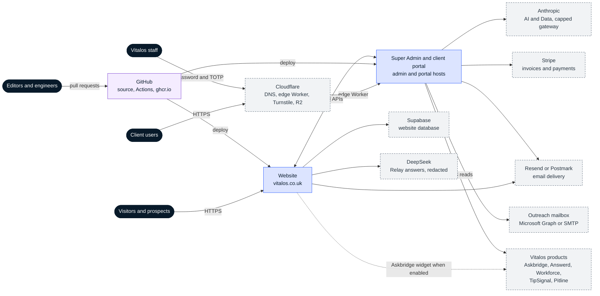
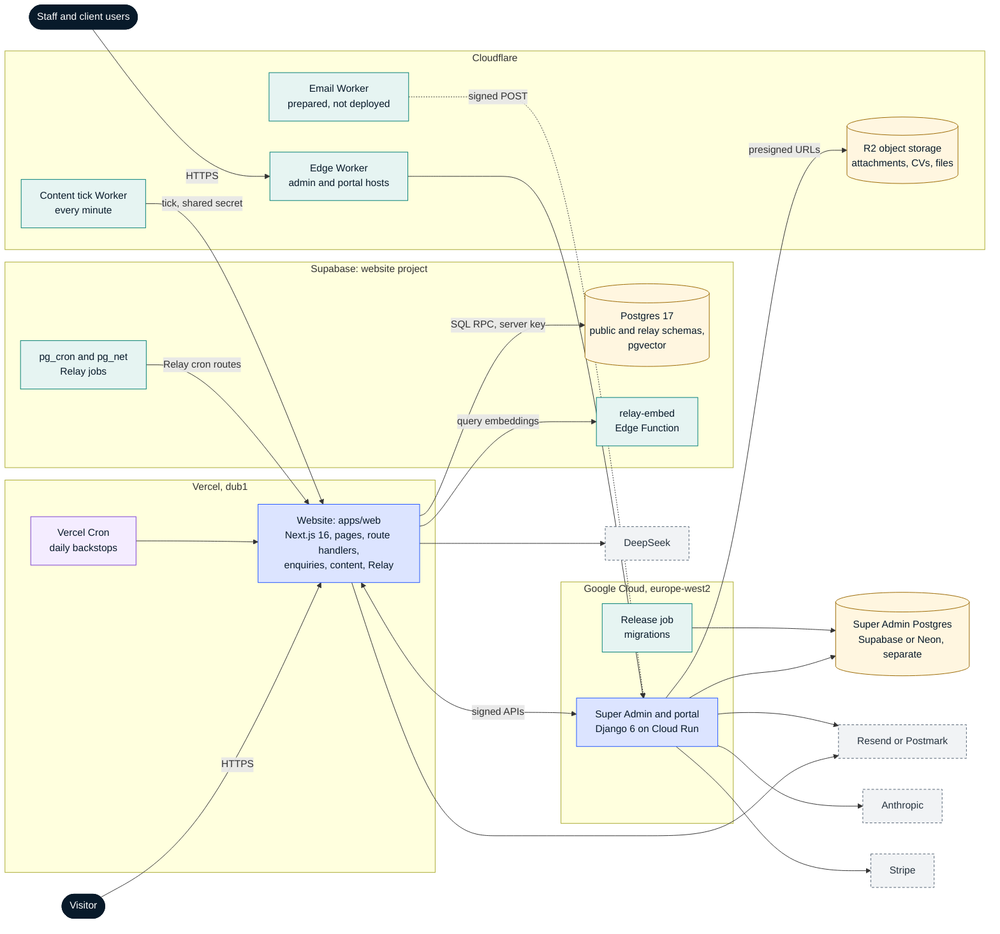

# Context and containers

Snapshot: 3 Nov 2026, commit `2096148`. Back to the [architecture index](README.md).

## System context (C4 level 1)

Four groups of people use the platform. Visitors and prospects use the public website. Client users sign in to the client portal. Vitalos staff use the Super Admin. Editors and engineers change the repository through pull requests. The platform depends on hosting (Vercel, Google Cloud, Cloudflare), a website database (Supabase), email delivery, two model providers, Stripe and an outreach mailbox. It also reads status from the other Vitalos products.

Notes:

- The website and the Super Admin are separate deployables with no source imports in either direction (ADR-026). Every call between them is an HMAC-signed HTTP request with per-scope keys (ADR-035, ADR-040).
- The public site assistant is Relay, built in this repository, unless the Askbridge site key is set at build time. Then the website loads the Askbridge widget instead (ADR-045).
- The Super Admin's Product Pipeline reads each product's status with a server-side Bearer-token GET and links staff to that product's own admin through an audited redirect. No credentials cross to the product (ADR-044).

## Containers (C4 level 2)

| Container                     | Technology                                               | Responsibility                                                                                                                                                                                 | Source                                              |
| ----------------------------- | -------------------------------------------------------- | ---------------------------------------------------------------------------------------------------------------------------------------------------------------------------------------------- | --------------------------------------------------- |
| Website                       | Next.js 16 App Router, React 19, Tailwind 4, zod         | 45 page routes. Repo content is static per deploy; Insights and Careers are read from the Super Admin content API. Enquiries, careers applications, Relay API, AI & Data brief, SEO, redirects | `apps/web`                                          |
| Vercel Cron                   | Vercel scheduled functions                               | Daily backstops: outbox dispatch, enquiry retention purge, content tick                                                                                                                        | `apps/web/vercel.json`                              |
| Website database              | Supabase PostgreSQL 17, pgvector, citext, pgcrypto       | Enquiries, notification outbox and rate limits (`public`); Relay conversations, knowledge and usage (`relay`)                                                                                  | `supabase/migrations`                               |
| relay-embed                   | Supabase Edge Function, gte-small (384 dimensions)       | Embeddings for Relay knowledge chunks and visitor questions                                                                                                                                    | `supabase/functions/relay-embed`                    |
| pg_cron and pg_net            | PostgreSQL extensions                                    | Relay reminders, hourly digest and FAQ sync through the website's Relay cron routes; the nightly Relay retention purge runs in the database                                                    | `supabase/migrations/20261015090100_relay_cron.sql` |
| Super Admin and client portal | Django 6, Python, gunicorn, django-otp, django-axes, DRF | Company architecture, enquiries and mail, Relay inbox, Insights, Careers, AI & Data pipeline and gateway, billing, outreach, client portal                                                     | `superadmin/`                                       |
| Release job                   | Cloud Run job                                            | Runs migrations and release steps before each new revision                                                                                                                                     | `superadmin/bin`, `superadmin/deploy/gcp/deploy.sh` |
| Super Admin database          | PostgreSQL on a Supabase or Neon free plan               | 102 Django models across 20 apps; never shared with the website                                                                                                                                | `superadmin/apps/*/models.py`                       |
| Edge Worker                   | Cloudflare Worker, managed outside this repository       | Carries `admin.` and `portal.` hosts to Cloud Run with a shared-secret header                                                                                                                  | `superadmin/docs/DEPLOY.md`                         |
| Content tick Worker           | Cloudflare Worker, cron every minute                     | Calls the website's tick route, which wakes the Super Admin only when scheduled work is due (ADR-042)                                                                                          | `infra/cloudflare-content-tick`                     |
| Email Worker                  | Cloudflare Email Worker, prepared and not deployed       | Forwards `support@` mail and posts the signed raw message to the Super Admin (ADR-029)                                                                                                         | `infra/cloudflare-email-worker`                     |
| R2 object storage             | Cloudflare R2 through the S3 API                         | Enquiry attachments, private CV bucket, portal files, content media                                                                                                                            | `superadmin/config/settings/base.py`                |
| Shared packages               | TypeScript, public entrypoints only                      | `cms`, `config`, `design-tokens`, `email-layout`, `observability`, `relay-core`, `relay-knowledge`, `relay-widget`, `security`, `ui`, `validation` and tooling packages                        | `packages/*`                                        |
| Storybook                     | Storybook                                                | Private component workbench; not deployed                                                                                                                                                      | `apps/storybook`                                    |

Boundaries are enforced in CI by `dependency-cruiser` (`pnpm check:boundaries`): no app-to-app imports, no cycles, no package-to-app imports, and `@vitalos/config` stays server-only. `services/` and `workers/` hold templates only; no service has been extracted (ADR-010).
