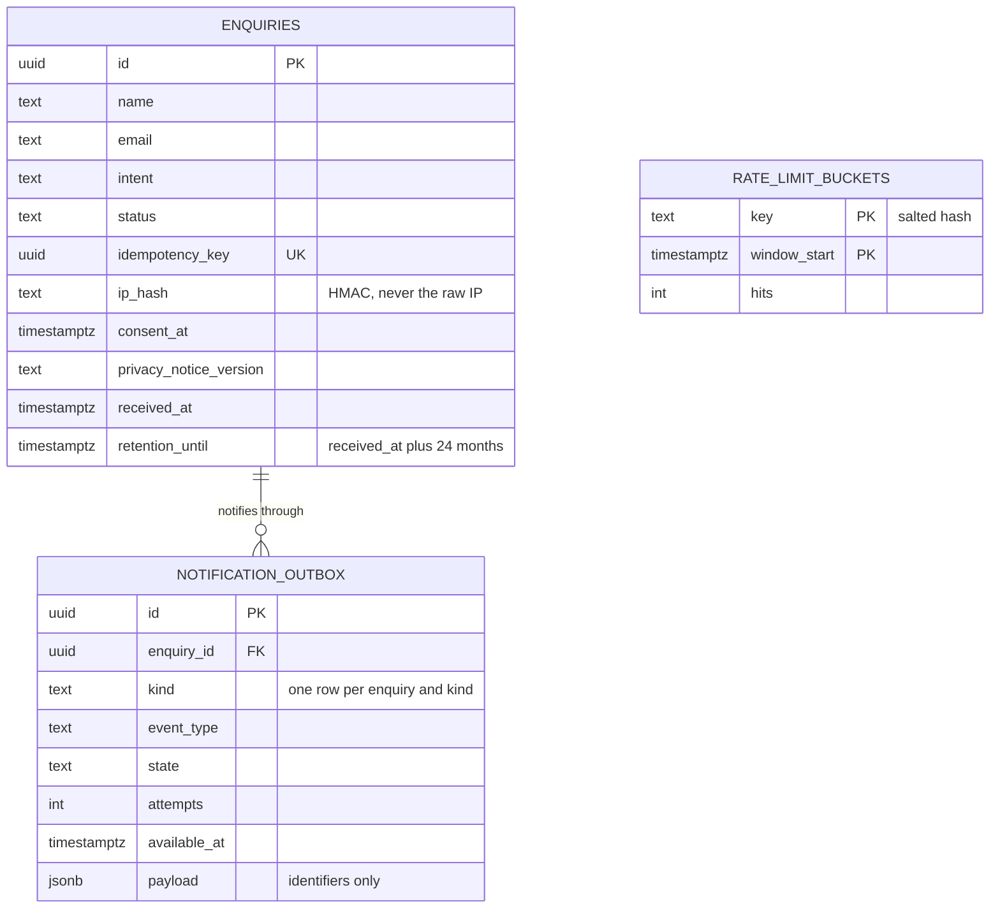
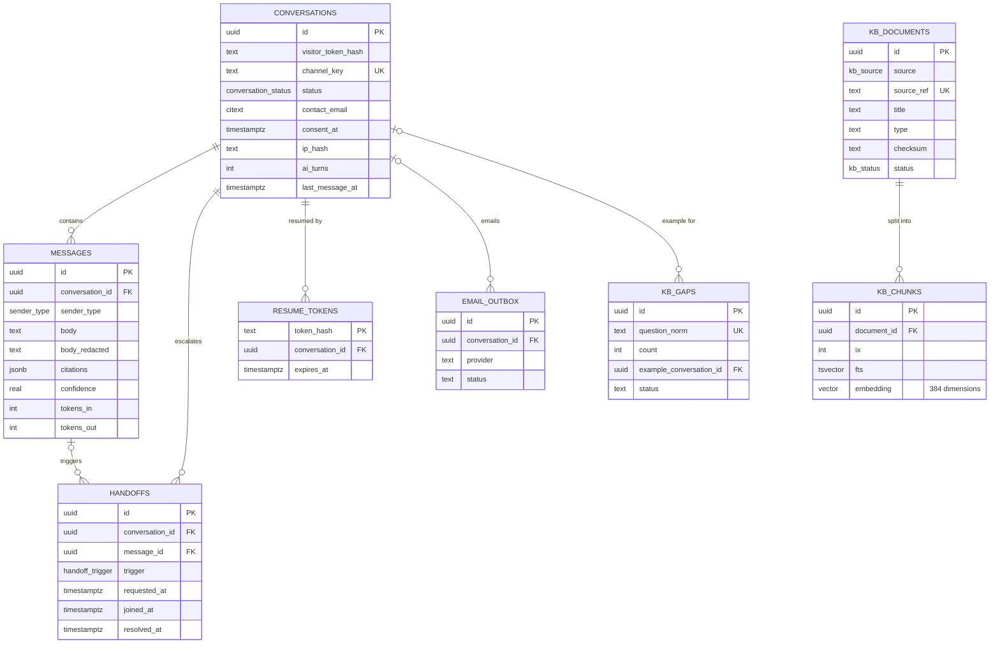
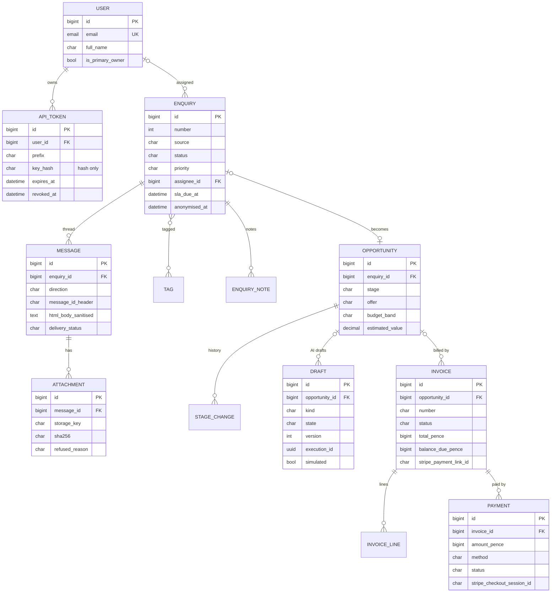
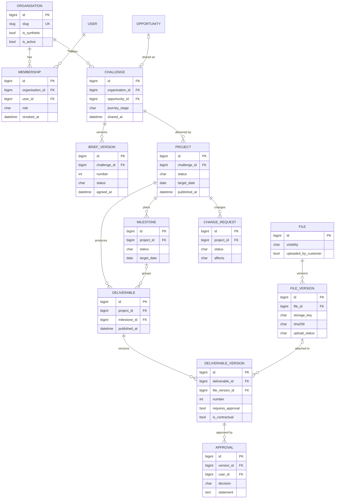
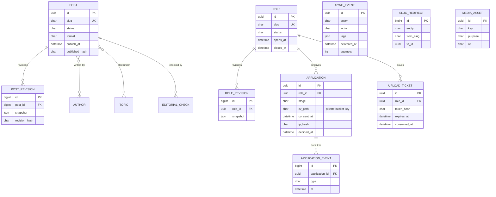
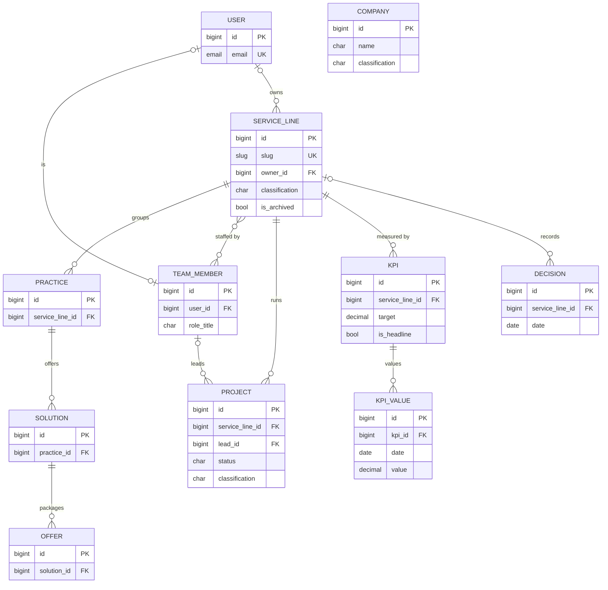

# Data model

Snapshot: 3 Nov 2026, commit `2096148`. Back to the [architecture index](README.md).

The platform has two databases with one owner each. Nothing is shared by writing to the other system's store.

| Store                         | Owner                          | Holds                                                                                                | Defined in                                                                 |
| ----------------------------- | ------------------------------ | ---------------------------------------------------------------------------------------------------- | -------------------------------------------------------------------------- |
| Website PostgreSQL (Supabase) | `apps/web` server code         | 17 tables: enquiries, outbox and rate limits in `public`; 14 Relay tables in `relay`                 | 8 SQL migrations in `supabase/migrations`, pgTAP tests in `supabase/tests` |
| Super Admin PostgreSQL        | `superadmin/` (Django)         | 102 models across 17 Django apps, plus history tables from `django-simple-history`                   | 42 Django migrations in `superadmin/apps/*/migrations`                     |
| Repository                    | Editors, through pull requests | Editorial content for the public site (ADR-028)                                                      | `packages/cms/src/repo`                                                    |
| R2 object storage             | Super Admin                    | Enquiry attachments, CVs (private bucket), portal files, content media; metadata stays in PostgreSQL | `superadmin/config/settings`                                               |

Diagrams show the primary key, foreign keys, the main constraint columns and two to four meaningful columns per table. Website types are PostgreSQL types; Super Admin types are Django field kinds.

## Website database: enquiries

- RLS is on for every table, and `anon` and `authenticated` have no privileges. Only server code with the Supabase secret key writes, through `SECURITY DEFINER` functions: `submit_enquiry`, `find_enquiry_reference`, `rate_limit_consume`, `claim_outbox_batch`, `mark_outbox` and `purge_expired_enquiries` (ADR-006, ADR-019).
- The enquiry and its outbox row are written in one transaction. A replayed idempotency key returns the original reference and writes nothing. Delivery is at least once, with one outbox row per enquiry and kind.
- The client IP is stored only as an HMAC under a server-side salt. Rate-limit keys are salted hashes. The outbox payload carries identifiers only; personal data is read from the enquiry at send time.
- Retention: a trigger sets `retention_until` to 24 months after receipt; a daily Vercel Cron calls `/api/internal/retention/purge`.

## Website database: Relay

Six more Relay tables stand alone: `kb_sync_runs` (ingest runs), `admin_presence` (staff availability), `settings` (one row of configuration), `usage_daily` (tokens, estimated cost and cap notices), `rate_limits` and `audit_log`.

- The `relay` schema has RLS on every table with no `anon` or `authenticated` policies. Only the website server, using the secret key, reads and writes it. Business rules live in `@vitalos/relay-core` (ADR-035).
- Retrieval is hybrid: a generated `tsvector` for full-text search and a 384-dimension `vector` for similarity, combined in `relay.match_chunks` (ADR-037).
- Knowledge is re-indexed by checksum from the repository, the Master FAQ and CMS content (`@vitalos/relay-knowledge`, the `Relay knowledge` workflow).
- `relay.purge_expired` runs nightly from `pg_cron`; `relay.forget_gap_examples` removes example questions from gaps. Retention periods are in `docs/relay/PRIVACY.md`.

## Super Admin: enquiries, AI & Data and billing

- Enquiries arrive from inbound mail (Email Worker or Resend), classified as person, form relay or automated (ADR-046). Message HTML is stored raw and sanitised separately.
- An enquiry can become an AI & Data `Opportunity`. AI work is a `Draft` with evidence and versions, and nothing is sent automatically (ADR-055). Every model call is metered as a standalone `ModelExecution` row (workflow, provider, model, tokens, cost in GBP, outcome).
- Billing amounts are integers in pence. Payment links and checkout sessions come from Stripe; Stripe webhooks are verified before a `Payment` is recorded (ADR-053).
- API tokens are stored as a hash with a prefix, and can expire or be revoked.

## Super Admin: client portal

The portal also has `Invitation`, `BriefReview`, `ProjectItem`, `ChangeReview`, `InformationRequest`, `InformationResponse`, `Thread`, `Message`, `Update`, `ManagedService`, `ServiceStatusReport`, `Event`, `Notification`, `NotificationPreference`, `EmailDelivery`, `PushSubscription` and `PushDelivery`.

- Every customer-facing record has an explicit publication state. Internal-only fields (`internal_notes`) are never rendered to customers, searched, emailed, exported or given to the AI (ADR-056).
- Approvals are tied to one deliverable version and keep the approver's name, email, role and statement. Approvals, organisations and audit records are decision evidence and are not deleted by cascade.
- Files keep their metadata and SHA-256 in PostgreSQL; the bytes live in private object storage.

## Super Admin: Insights, Careers and content sync

- Insights and Careers are managed in the Super Admin and served to the website through the signed content API (ADR-039, ADR-040). Each publish writes a revision and a `SyncEvent` outbox row in the same transaction as the change.
- CVs never pass through the website: the browser uploads to a pre-signed URL issued against an `UploadTicket`. Applications are deleted six months after the decision; the job runs as a dry run until retention is switched on by a person (ADR-041).

## Super Admin: company architecture

- These models inherit `GovernedModel`: created and updated by, a classification (Public, Internal, Confidential, Restricted), archive instead of delete, and full history (ADR-026).
- `Practice`, `Solution` and `Offer` share the abstract `Offering` base.

## Table inventory

### Website database (17 tables)

| Schema   | Tables                                                                                                                                                                                                    |
| -------- | --------------------------------------------------------------------------------------------------------------------------------------------------------------------------------------------------------- |
| `public` | `enquiries`, `notification_outbox`, `rate_limit_buckets`                                                                                                                                                  |
| `relay`  | `conversations`, `messages`, `handoffs`, `resume_tokens`, `kb_documents`, `kb_chunks`, `kb_gaps`, `kb_sync_runs`, `admin_presence`, `settings`, `usage_daily`, `rate_limits`, `audit_log`, `email_outbox` |

### Super Admin database (102 models)

| App                   | Models                                                                                                                                                                                                                                                                                                                                                                                                    |
| --------------------- | --------------------------------------------------------------------------------------------------------------------------------------------------------------------------------------------------------------------------------------------------------------------------------------------------------------------------------------------------------------------------------------------------------- |
| `accounts` (2)        | User, ApiToken                                                                                                                                                                                                                                                                                                                                                                                            |
| `aicore` (2)          | ModelExecution, AiSettings                                                                                                                                                                                                                                                                                                                                                                                |
| `aidata` (9)          | PipelineSettings, Opportunity, OpportunityNote, StageChange, OfferPrice, BudgetSettings, CostEntry, Draft, BriefAssistEvent                                                                                                                                                                                                                                                                               |
| `architecture` (10)   | Company, ServiceLine, Practice, Solution, Offer, TeamMember, Project, KPI, KPIValue, Decision                                                                                                                                                                                                                                                                                                             |
| `audit` (1)           | AuditEvent                                                                                                                                                                                                                                                                                                                                                                                                |
| `billing` (4)         | BillingSettings, Invoice, InvoiceLine, Payment                                                                                                                                                                                                                                                                                                                                                            |
| `careers` (8)         | Role, RoleRevision, Application, ApplicationNote, ApplicationEvent, CareersSettings, UploadTicket, CareersAlertEmail                                                                                                                                                                                                                                                                                      |
| `content_sync` (6)    | SyncEvent, SlugRedirect, SiteSettings, SiteSection, TickState, MediaAsset                                                                                                                                                                                                                                                                                                                                 |
| `email_templates` (3) | EmailTemplate, EmailTemplateVersion, EmailSuppression                                                                                                                                                                                                                                                                                                                                                     |
| `enquiries` (9)       | Tag, Enquiry, Message, Attachment, EnquiryNote, CannedResponse, InboxSettings, NotificationPreference, OutboundNotification                                                                                                                                                                                                                                                                               |
| `insights` (8)        | Author, Topic, Post, PostAuthor, PostTopic, PostRelated, PostRevision, EditorialCheck                                                                                                                                                                                                                                                                                                                     |
| `notifications` (1)   | Notification                                                                                                                                                                                                                                                                                                                                                                                              |
| `outreach` (2)        | OutreachSettings, Contact                                                                                                                                                                                                                                                                                                                                                                                 |
| `portal` (29)         | Organisation, Membership, Invitation, Challenge, BriefVersion, BriefReview, Project, ProjectItem, Milestone, Deliverable, DeliverableVersion, Approval, ChangeRequest, ChangeReview, InformationRequest, InformationResponse, Thread, Message, Update, File, FileVersion, ManagedService, ServiceStatusReport, Event, Notification, NotificationPreference, EmailDelivery, PushSubscription, PushDelivery |
| `products` (1)        | ProductAccess                                                                                                                                                                                                                                                                                                                                                                                             |
| `recon_demo` (2)      | ReconRun, ReviewItem                                                                                                                                                                                                                                                                                                                                                                                      |
| `relay` (5)           | RelayNotification, RelayPreference, RelayAlertLog, RelayInboundEvent, RelayInboxState                                                                                                                                                                                                                                                                                                                     |

`core` holds the abstract `GovernedModel`; `api` and `mailer` have no models.
