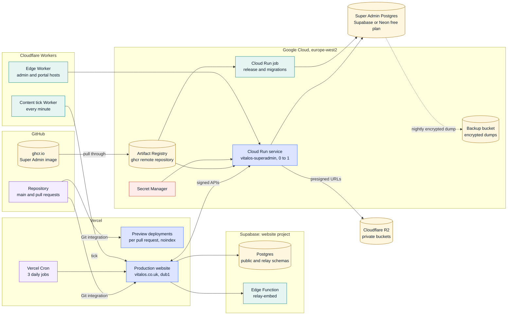
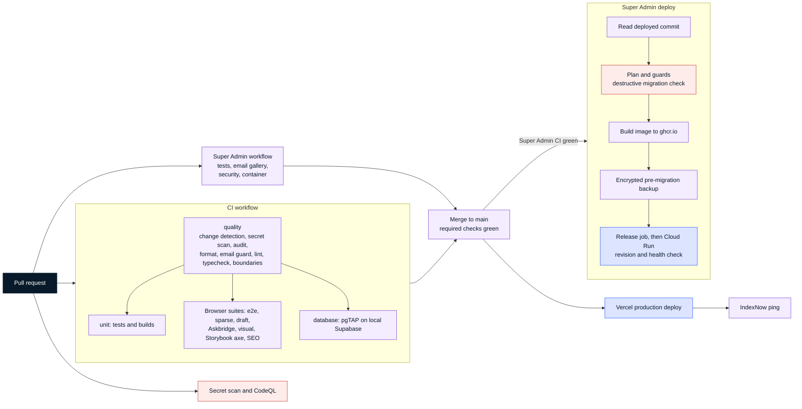

# Deployment and CI/CD

Snapshot: 3 Nov 2026, commit `2096148`. Back to the [architecture index](README.md).

## Runtime topology

| Part                   | Runs on                                                                                             | Deployed by                                                                               | Notes                                                                                           |
| ---------------------- | --------------------------------------------------------------------------------------------------- | ----------------------------------------------------------------------------------------- | ----------------------------------------------------------------------------------------------- |
| Website                | Vercel, region `dub1`                                                                               | Vercel Git integration: `main` to production, pull requests to previews                   | Three daily Vercel Cron jobs in `apps/web/vercel.json`                                          |
| Website database       | Supabase project (PostgreSQL 17, Edge Functions, `pg_cron`)                                         | Migrations in `supabase/migrations`; knowledge by the `Relay knowledge` workflow          | Local stacks run the same migrations; CI runs pgTAP against a local stack                       |
| Super Admin and portal | Google Cloud Run service `vitalos-superadmin`, `europe-west2`, 0 to 1 instances, 1 vCPU and 512 MiB | `Super Admin deploy` workflow through Workload Identity Federation (OIDC, no stored keys) | Moved from Azure to Google Cloud on 1 Nov 2026 (`superadmin/docs/DEPLOY.md`)                    |
| Release job            | Cloud Run job `vitalos-superadmin-release`                                                          | Same workflow, before each revision                                                       | Migrations run after a fresh encrypted backup                                                   |
| Super Admin image      | ghcr.io, pulled through an Artifact Registry remote repository                                      | `Super Admin deploy` build job                                                            | Tagged with the commit SHA; the three newest versions are kept                                  |
| Super Admin database   | Supabase (default) or Neon free plan, London                                                        | Django migrations from the release job                                                    | Separate from the website's database; nightly encrypted dump to a private Cloud Storage bucket  |
| Runtime secrets        | Google Secret Manager, `europe-west2`                                                               | Written by the deploy script; only the runtime service account reads them                 | GitHub environments hold deploy-time values; Vercel holds the website's                         |
| Edge Worker            | Cloudflare Workers, on the `admin` and `portal` hosts                                               | Outside this repository; workflows never change DNS or Cloudflare                         | Adds a shared-secret header that the Super Admin checks                                         |
| Content tick Worker    | Cloudflare Workers cron, every minute                                                               | `wrangler deploy` from `infra/cloudflare-content-tick`                                    | Calls the website tick route; the website wakes the Super Admin only when work is due (ADR-042) |
| Email Worker           | Cloudflare Email Routing                                                                            | Prepared in `infra/cloudflare-email-worker`; deploying it is an owner step                | Proposed in ADR-029                                                                             |

## Environments

| Environment | Website                                                                                                      | Super Admin                                                                       | Data                                                                 |
| ----------- | ------------------------------------------------------------------------------------------------------------ | --------------------------------------------------------------------------------- | -------------------------------------------------------------------- |
| Local       | `pnpm dev:web`; content source `repo`, `draft`, `fixtures` or `empty`; enquiries in memory or local Supabase | Docker Compose with its own PostgreSQL                                            | Local Supabase stack in Docker; artificial fixtures only             |
| Preview     | Vercel preview per pull request; `noindex` on every response; `draft` content allowed                        | None                                                                              | Separate secrets and data; production data is never copied (ADR-015) |
| Staging     | Not provisioned; Vercel Preview is the current intent (ADR-015)                                              | None                                                                              | None                                                                 |
| Production  | `vitalos.co.uk` from `main`; only the canonical production host is indexable (ADR-043)                       | `admin.vitalos.co.uk`, and `portal.vitalos.co.uk` once its domain binding is done | Website Supabase project; Super Admin PostgreSQL; R2                 |

## CI/CD pipeline

- `quality` runs first and decides what else a pull request needs (`tooling/scripts/ci-changes.mjs`): Turborepo `--affected` on pull requests, the full suite on `main`. Markdown, `docs/` and the Super Admin start nothing beyond `quality` in this workflow.
- Browser suites and pgTAP skip draft pull requests. Pull request runs cancel in progress; Super Admin pushes to `main` are never cancelled, so every commit gets a complete run to deploy from.
- Third-party actions are pinned to full commit SHAs, workflows default to `contents: read`, and deploy and data secrets live in the `production` and `backup` environments, so pull request jobs run without them.

## Workflows

| Workflow                | Trigger                                                                               | Runner and environment                       | What it does                                                                                                                        | Deploys to                     |
| ----------------------- | ------------------------------------------------------------------------------------- | -------------------------------------------- | ----------------------------------------------------------------------------------------------------------------------------------- | ------------------------------ |
| `ci.yml`                | Pull requests; pushes to `main` on code paths; manual                                 | `ubuntu-latest`                              | `quality` gate, then affected unit tests and builds, e2e (fixtures, sparse, draft, Askbridge), visual, Storybook axe, SEO and pgTAP | None (Vercel deploys from Git) |
| `superadmin.yml`        | Pull requests and pushes to `main` touching `superadmin/` or the content API contract | `ubuntu-latest` with a PostgreSQL 17 service | Ruff, tests and deploy checks, email gallery, pip-audit and bandit, container build and browser smoke test                          | Feeds the deploy               |
| `superadmin-deploy.yml` | `workflow_run` of `Super Admin` on `main`; manual with `confirm=DEPLOY`               | `ubuntu-latest`, `production` environment    | Read the deployed commit, plan and guards, build to ghcr.io, backup, release job, new revision, health check                        | Google Cloud Run               |
| `backup.yml`            | Nightly at 02:00 UTC; dispatched before every deploy                                  | `ubuntu-latest`, `backup` environment        | `pg_dump` of the Super Admin database, encrypted with GPG, stored in a private bucket                                               | Cloud Storage                  |
| `relay-knowledge.yml`   | Pushes to `main` touching Relay knowledge or site content; manual                     | `ubuntu-latest`, `production` environment    | Ingests and re-embeds Relay knowledge                                                                                               | Website Supabase               |
| `ai-data-live-eval.yml` | Manual only, from `main`                                                              | `ubuntu-latest`, `production` environment    | Live run of the reconciliation demonstrator against the configured provider, capped at 40 calls, synthetic data only                | None                           |
| `codeql.yml`            | Pull requests and pushes on code paths; weekly                                        | `ubuntu-latest`                              | CodeQL for JavaScript and TypeScript                                                                                                | None                           |
| `secret-scan.yml`       | Pull requests and pushes to `main`                                                    | `ubuntu-latest`                              | gitleaks                                                                                                                            | None                           |
| `audit.yml`             | Weekly on Monday; manual                                                              | `ubuntu-latest`                              | Tracked-file secret patterns and `pnpm audit --audit-level high`                                                                    | None                           |
| `indexnow.yml`          | `deployment_status` from Vercel                                                       | `ubuntu-latest`                              | Pings IndexNow with the URLs that changed since the previous production deployment                                                  | IndexNow                       |

Dependabot updates actions and dependencies (`.github/dependabot.yml`). There are no self-hosted runners on this repository.
