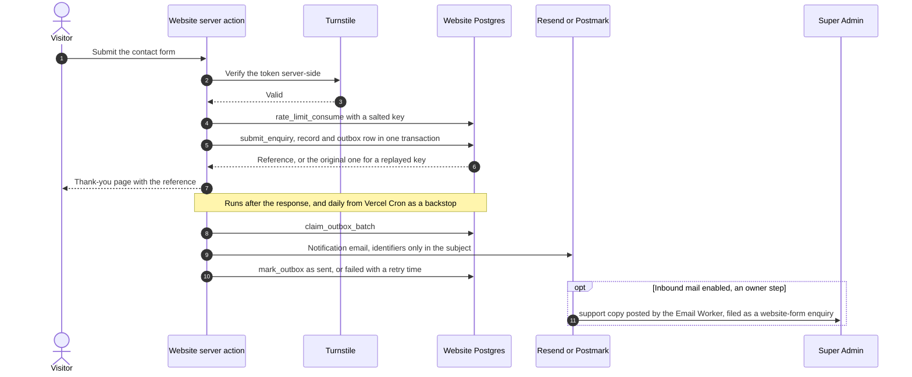
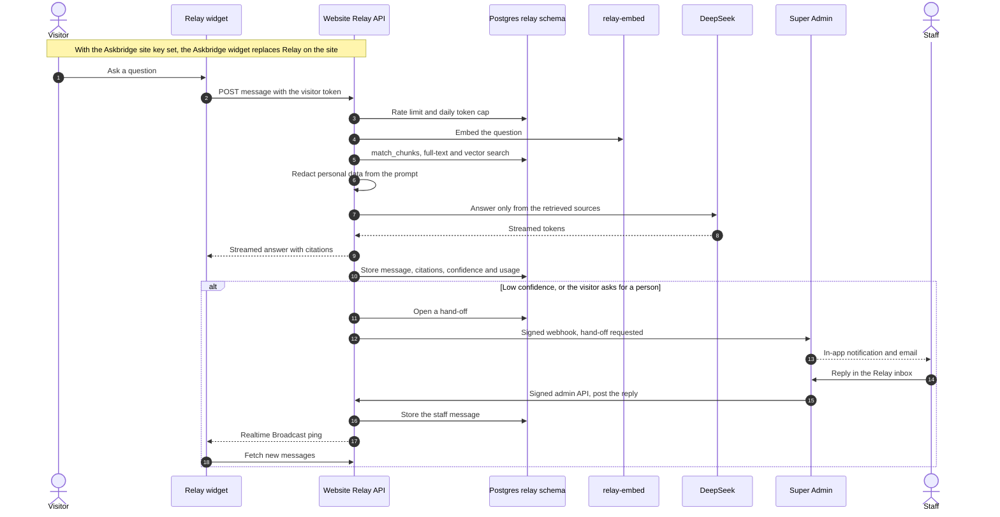
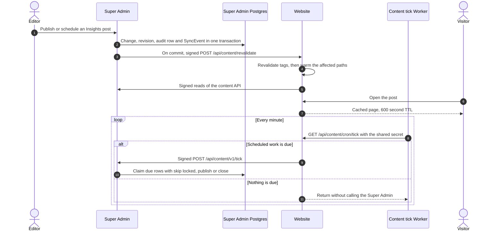
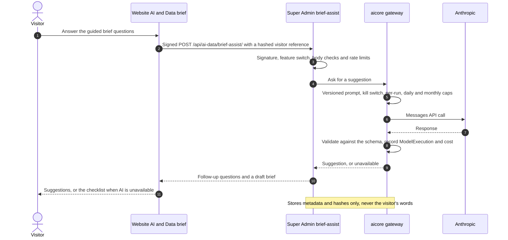
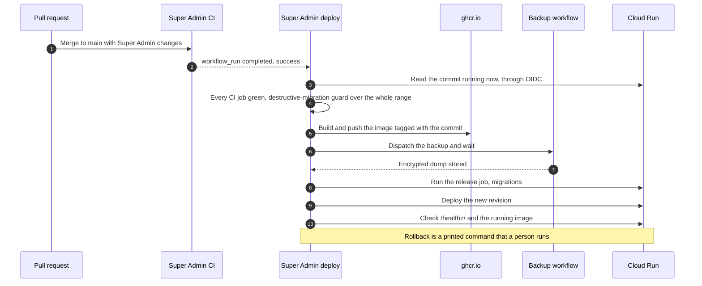
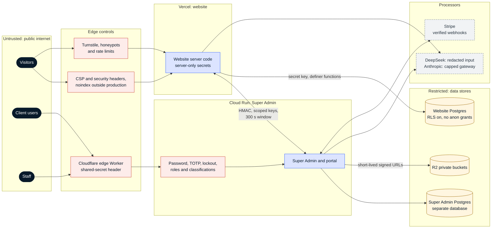

# Key flows and security

Snapshot: 3 Nov 2026, commit `2096148`. Back to the [architecture index](README.md).

## Key flows

### 1. Website enquiry

The record is written before anything is sent. Email is a notification channel, never the record (ADR-019).

### 2. Relay answer and hand-off to a person

Relay answers only from retrieved Vitalos content, shows citations, and hands the conversation to staff below a confidence floor (ADR-035 to ADR-038).

### 3. Publishing Insights and the content tick

The Super Admin owns Insights and Careers. The website caches signed reads and is told when to revalidate (ADR-039, ADR-040, ADR-042).

### 4. AI & Data brief assist

Every model call goes through the `apps.aicore` gateway, which enforces the kill switch and the per-run, daily and monthly caps (ADR-052, ADR-055).

### 5. Super Admin deploy

A merge to `main` deploys the exact commit that CI tested, after guards and a fresh encrypted backup.

## Security

### Trust boundaries

### Authentication

| Who                   | How                                                                                                                                                                             |
| --------------------- | ------------------------------------------------------------------------------------------------------------------------------------------------------------------------------- |
| Website visitors      | No accounts. Forms use Turnstile, honeypots and salted rate limits. Relay visitors hold a random token whose hash is stored.                                                    |
| Staff (Super Admin)   | Email and password, lockout after repeated failures (django-axes), TOTP required for SuperAdmin and for anyone who enrols a device, 8-hour sessions with HttpOnly cookies       |
| Client users (portal) | Invitations to an organisation membership; the portal host serves only portal URLs, and host-only cookies keep admin and portal sessions apart (ADR-056)                        |
| Machine to machine    | HMAC-SHA256 over timestamp, method, path, identity and body hash, with a key list per scope and a 300-second window (Relay admin API, Relay webhook, content API, brief assist) |
| Super Admin read API  | Bearer API tokens stored as a hash and a prefix, with expiry and revocation                                                                                                     |
| CI to Google Cloud    | Workload Identity Federation (OIDC) bound to this repository's `production` environment; no stored cloud keys                                                                   |

### Authorisation

- Super Admin roles are SuperAdmin, ServiceLead and Viewer. Every decision goes through `apps/accounts/roles.py`. Records carry a classification (Public, Internal, Confidential, Restricted) that limits who can see them.
- Product access is a separate permission per product (for example, opening the Askbridge admin), and each redirect is audited (ADR-044).
- Portal users see only their own organisation's published records through scoped selectors. Internal notes are never shown to customers.
- The website has no user roles. Its database grants nothing to `anon` or `authenticated`; only server code with the secret key calls the `SECURITY DEFINER` functions.

### Secrets

| Where                           | Holds                                                                    |
| ------------------------------- | ------------------------------------------------------------------------ |
| Vercel environment variables    | Website server secrets: database key, signing keys, email provider key   |
| GitHub `production` environment | Super Admin deploy values and the Relay ingest credentials               |
| GitHub `backup` environment     | Read-only backup connection and the backup passphrase                    |
| Google Secret Manager           | Super Admin runtime secrets; only the runtime service account reads them |
| Cloudflare Worker secrets       | Tick and inbound mail Worker secrets, set with `wrangler secret put`     |

`@vitalos/config` is server-only and validates every variable at build time. CI scans the client bundle for secrets, gitleaks scans every pull request, and a tracked-file pattern scan runs in `quality` and weekly. Names are documented in `.env.example`; values are never committed (`docs/security/secret-management.md`).

### Data protection

- Personal data is kept to what each feature needs. IP addresses are stored only as HMACs; analytics events are a closed, non-personal taxonomy.
- Retention: enquiries 24 months; Relay data by the nightly purge; job applications six months after the decision, as a dry run until a person switches enforcement on.
- Relay redacts personal data before every model call; the model sees only the redacted copy. The AI & Data gateway checks limits before each call, validates output against a schema and never logs prompts or outputs. Brief assist stores metadata and hashes of visitor input, never the words. Simulated or synthetic data is labelled.
- Logs carry identifiers, counts and error codes only; credential and personal-data keys are redacted.
- Production data is never copied to preview or local environments. The Super Admin database is backed up nightly as an encrypted dump.

### Browser and edge controls

- CSP with no third-party script origins except Turnstile, and the Askbridge origin only when its key is set; `frame-ancestors 'none'`; `nosniff`, a strict referrer policy and a restrictive permissions policy (ADR-020, ADR-045).
- Non-production responses carry `X-Robots-Tag: noindex`, failing closed for unknown environments.
- Client request IDs are accepted only in a strict format; otherwise a new one is generated.

### Main risks

Kept at design level because this repository is public. The full threat model is `docs/security/threat-model.md`.

| Risk                                       | Mitigation in place                                                                         | Open                                                                                             |
| ------------------------------------------ | ------------------------------------------------------------------------------------------- | ------------------------------------------------------------------------------------------------ |
| Leaked signing key between the two apps    | Per-scope key lists, rotation without downtime, 300-second replay window                    | Keys are rotated by hand                                                                         |
| Model provider receives personal data      | Relay redacts before each call; AI & Data has caps, a kill switch and metadata-only storage | Pattern-based redaction cannot catch everything; AI & Data relies on input limits, not redaction |
| Single Super Admin instance on a free plan | Scale to zero with one instance; nightly encrypted backups; pre-migration backup            | No high availability; the free-plan database is the only copy apart from the dumps               |
| Supply-chain compromise                    | Pinned actions, Dependabot, `pnpm audit`, pip-audit, bandit, CodeQL                         | Advisories are tracked in `docs/security/dependency-advisories.md`                               |
| Inbound mail spoofing                      | Signed Worker posts; form headers trusted only from Vitalos addresses (ADR-046)             | The Email Worker is not deployed yet                                                             |
